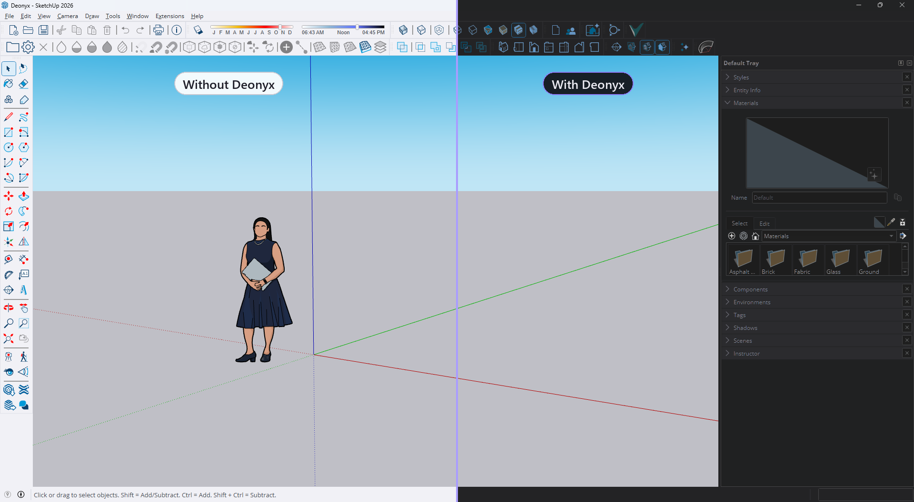
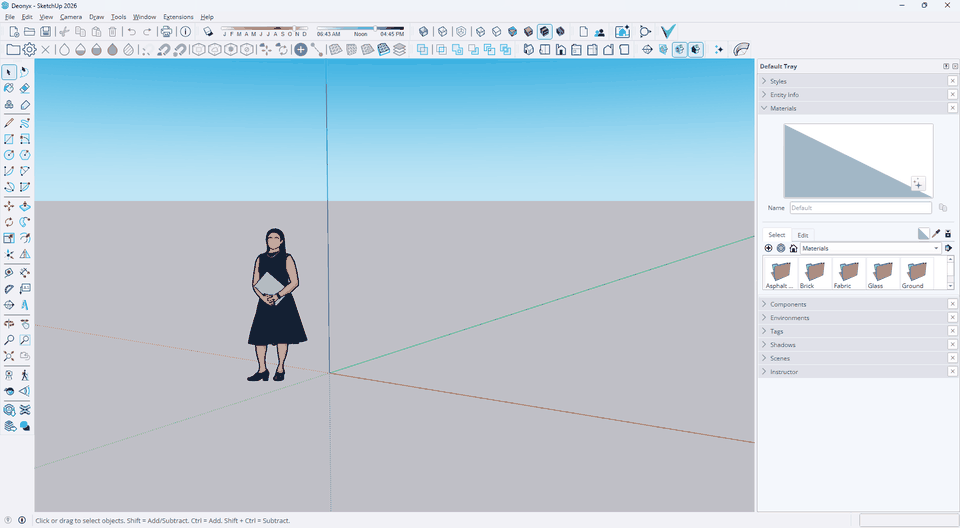
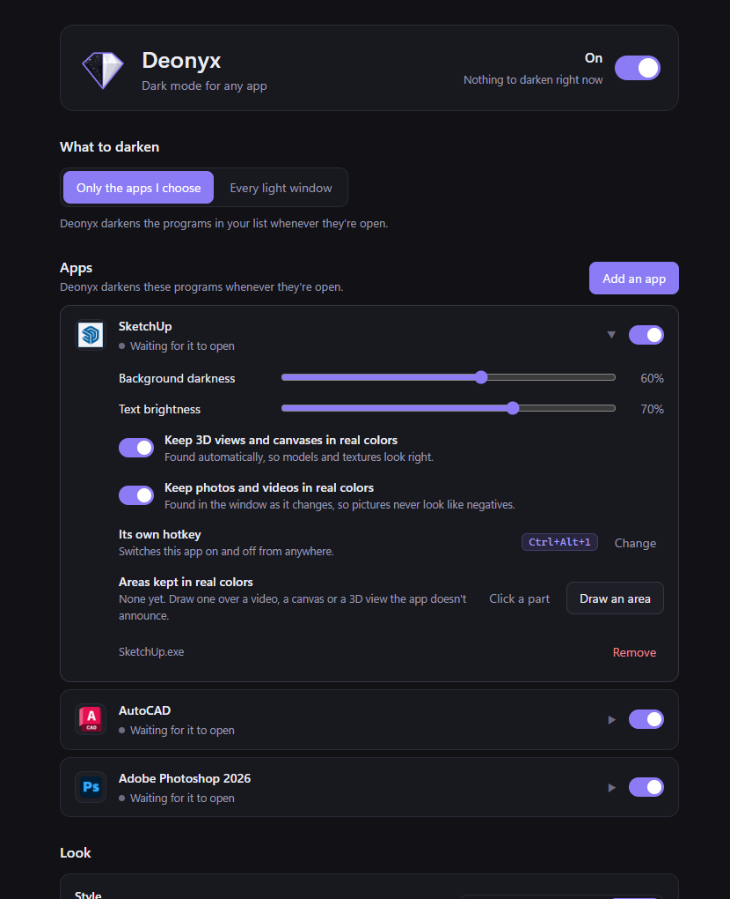
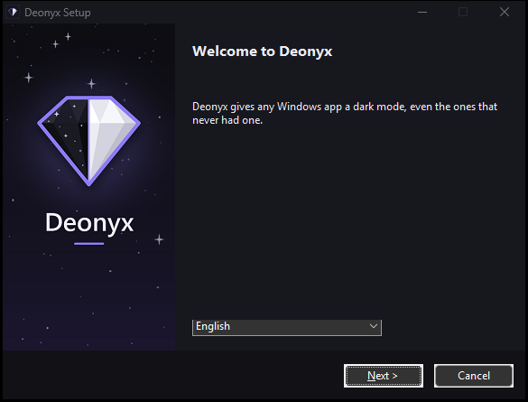

<p align="center">
  
</p>

<h1 align="center">Deonyx</h1>

<p align="center">
  <b>Dark mode for any Windows app.</b><br>
  Flicker-free, smart about what it darkens, and your 3D views keep their real colors.
</p>

<p align="center">
  <a href="https://github.com/fdeox/deonyx/releases/latest"></a>
  
  <a href="LICENSE"></a>
  <a href="https://discord.gg/5Z6XRtKG2V"></a>
</p>

<p align="center">
  
  <br>
  <sub>SketchUp, left as it is and right with Deonyx. Menus, toolbars and panels go dark; the 3D view keeps its real colors.</sub>
</p>

## Why

Plenty of Windows apps still have no dark mode. SketchUp is one of them, and its users have been asking for one for years. The tools that fill the gap today are paid, and they simply invert colors: textures and pictures come out wrong, and the screen flashes white when you switch windows.

Deonyx is free, and it does it properly.

## How it works

<p align="center">
  
  <br>
  <sub>Ctrl+Alt+D switches darkening on and off, with a short fade.</sub>
</p>

- **Lightness, not colors.** Deonyx flips only how light each pixel is, measured the way the eye sees it (OKLab). White turns dark grey, black text turns soft white, and red stays red.
- **Your 3D view stays real.** Viewports, canvases and pictures are found automatically through Windows UI Automation and keep their original colors.
- **Photos stay photos.** Pictures and videos inside a window are found as they appear and kept in their real colors, so nothing ever looks like a film negative.
- **Every window of the app.** Menus, lists, tooltips and dialogs are darkened too, in less than a frame after they appear.
- **No flash.** The dark layer is tied to the app's own window, so switching windows never shows the light version.
- **Leaves dark things alone.** A window that is already dark is shown as it is.
- **Never touches the app.** Deonyx captures the window with Windows.Graphics.Capture and draws the result in a click-through layer on top of it. Nothing is injected into the app, and nothing it shows leaves your PC.

## What you can do



- **Your apps, or every light window.** Pick the apps to darken, or let Deonyx darken every light window and keep a list of programs it leaves alone.
- **Tune each app.** Its own background darkness and text brightness. Well-known apps start with settings that suit them.
- **Pick a look.** Gray is easy on the eyes, Black suits OLED screens, Soft lowers the contrast, Paper is warm and calm for long reading. Faint gray text stays readable, a warm tint makes evenings easier, and each screen can have its own look, or none at all.
- **Profiles.** Keep setups like Day, Night or Presenting under a name and switch in one click, from the settings, the tray, a Stream Deck key or the command line.
- **Choose when.** Always, whenever Windows is in dark mode, between the hours you set, or from sunset to sunrise where you live. On battery it can keep going, save power, or pause. It also steps aside by itself while the games or programs you pick are running.
- **Keep real colors where you want them.** Click a video, a canvas or a 3D view, or draw a box over it, and it stays as it is, even when the window is resized.
- **Peek at the real colors.** Hold Ctrl+Alt+P and every window shows its real colors until you let go. Handy for picking a color.
- **Share your screen in real colors.** Screen sharing and screenshots can show your apps as they really are, while you keep seeing them dark. Always, or only while Zoom or Webex shares or OBS, Streamlabs or XSplit runs.
- **Ask why.** Click any window and Deonyx tells you why it is or isn't dark, with a button that fixes it when it can. If the app has a dark mode of its own, it tells you where.
- **Hotkeys you choose.** Ctrl+Alt+D turns darkening on and off, Ctrl+Alt+F darkens or restores the app in front of you, Ctrl+Alt+W does it for just the window under the mouse, and each app can have a hotkey of its own. Change any of them in the settings.
- **A tray window.** Click the tray icon to switch apps on and off, change the look or the profile, or pause for an hour. Right-click Deonyx on the taskbar or in Start for quick tasks.
- **Command line.** `deonyx --toggle`, `--on`, `--off`, `--front`, `--window`, `--app SketchUp.exe on|off`, `--pause 30`, `--resume`, `--profile Night`, and `--status` for the state as JSON. Handy for AutoHotkey and scripts.
- **Stream Deck.** The Deonyx plugin puts darkening, pausing, apps, profiles and the window under the mouse on keys that show their state. Get `Deonyx-1.0.0.streamDeckPlugin` from the [latest release](https://github.com/fdeox/deonyx/releases/latest) and open it.
- **Run as administrator** to darken apps like Task Manager. Normal apps are still darkened without administrator rights, so tools like AutoHotkey keep working in them.
- **Start with Windows** and wait quietly in the tray.
- **13 languages:** English, Türkçe, Deutsch, Français, Español, Italiano, Português, Nederlands, Русский, Українська, 日本語, 한국어 and 简体中文.
- **Tells you when a new version is out** with a green dot on the tray icon, and updates in one click. It also brings a "Copy diagnostics" button for bug reports. If something fails, Deonyx gets back up by itself and keeps a report you can send.

<br clear="right">

## Install



Download `Deonyx_..._x64-setup.exe` from the [latest release](https://github.com/fdeox/deonyx/releases/latest) and run it. It installs for your user only, without administrator rights. On a Windows on ARM PC, try the experimental `Deonyx_..._arm64-setup.exe`. Deonyx needs Windows 11, or Windows 10 version 2004 or later. On Windows 10 it copies the screen instead of capturing each window, because Windows 10 draws a yellow border around every captured window.

Deonyx isn't code-signed, so Windows SmartScreen may say it protected your PC. Click **More info**, then **Run anyway**.

Deonyx lives in the tray. Click its icon, choose **Add an app**, and pick a program from the open or installed ones. Settings are kept in `%APPDATA%\Deonyx\config.json`. To remove Deonyx, uninstall it from Settings > Apps like any other app.

<br clear="right">

## Help and ideas

Questions, bugs or ideas? Join the [Deonyx Discord](https://discord.gg/5Z6XRtKG2V): there's a help forum, bug reports and suggestions, and every new version is announced there. You can also open an [issue](https://github.com/fdeox/deonyx/issues).

## Ready settings for apps

[presets.json](presets.json) holds what Deonyx knows about well-known apps: where their own dark mode is, render windows best left alone, a darkness that suits them, and how to find their 3D views. Deonyx picks up the newest copy from this repository, so an app added there reaches everyone without a new version. Know an app that needs one? Open a pull request or tell us on Discord.

## Privacy

Deonyx sends nothing anywhere. The only things it asks the internet for, both from this repository, are whether a new version is out and the newest [presets.json](presets.json). Turn off updates in its settings and it asks for nothing. Even the sunset and sunrise times are worked out on your PC from the city you pick.

## Build

Needs [Rust](https://rustup.rs).

```
cargo build --release
target\release\deonyx.exe
```

The installer is built with the [Tauri CLI](https://v2.tauri.app/reference/cli/): `cargo tauri build --bundles nsis`.

The Stream Deck plugin lives in [streamdeck](streamdeck) and needs [Node.js](https://nodejs.org): `npm install`, then `node build.mjs --pack`.

## License

Copyright (C) 2026 fdeox

Deonyx is free software under the GNU General Public License, version 3. See [LICENSE](LICENSE).

### Name and logo

The Deonyx name and logo are not covered by the GPL. They identify the official app made by fdeox. You are welcome to fork the code under the GPL, but a fork must use its own name and logo.
